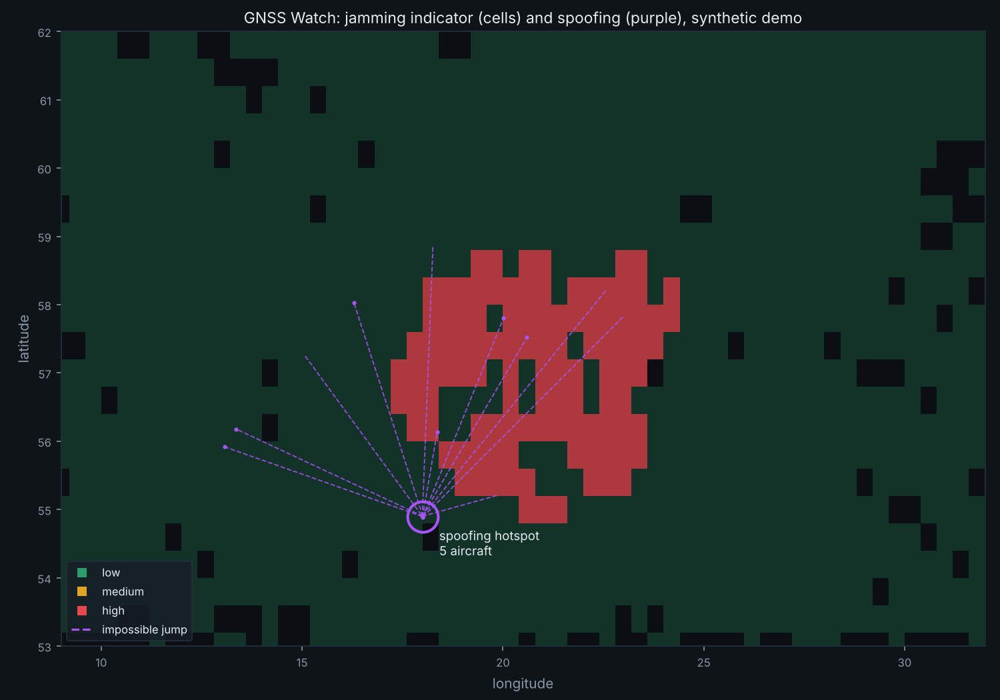
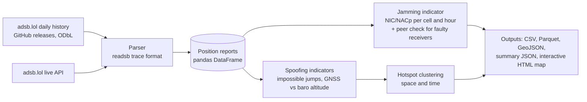

# GNSS Watch

[](https://github.com/abdullah1307-git/gnss-watch/actions/workflows/ci.yml)


**Detecting GPS/GNSS jamming and spoofing that affects aircraft, using only open ADS-B data.**

GNSS Watch reads the position reports that aircraft broadcast (ADS-B) and finds two kinds
of satellite navigation interference:

- **Jamming**: areas where many aircraft at once report degraded GNSS integrity.
- **Spoofing**: aircraft whose positions "teleport" in physically impossible ways, and
  places where several aircraft are pulled to the same fake location.


<sub>Output of `gnsswatch demo` on synthetic data with injected jamming (red area) and a spoofing
attack that pulls aircraft onto one fake position (purple).</sub>

## Why this matters

GNSS interference has become one of the most discussed safety issues in European aviation.
The Baltic Sea region, close to Berlin, is among the most affected areas.

- The EU Commissioner for Defence told the European Parliament that about 40% of civil
  flights in Europe operate in areas affected by jamming and spoofing
  ([BTA](https://www.bta.bg/en/news/964408-around-40-of-civil-flights-in-europe-operate-in-areas-with-jammed-satellite-nav)).
- IATA safety data shows spoofing incidents nearly tripled and jamming rose 67% between 2023
  and 2025 ([summary](https://migflug.com/jetflights/gps-spoofing-up-193-pilots-are-flying-blind/)).
- In July 2026 EASA published the fourth revision of its safety bulletin on GNSS outages,
  and industry welcomed its recognition of near-real-time interference maps
  ([overview](https://geoawesome.com/easa-updates-gnss-guidance-as-jamming-and-spoofing-surge-what-geospatial-professionals-need-to-know/)).

Public maps mostly show **daily jamming**. GNSS Watch adds **spoofing detection** with
physics-based checks, filters out **faulty receivers** that would otherwise cause false
alarms, and is built to run on a schedule for near-real-time updates.

## How it works



| Indicator | Signal | Why it works |
|---|---|---|
| Jamming ratio | Share of aircraft per cell and hour with NIC < 7 or NACp < 8 | Jamming degrades every receiver in an area at once |
| Faulty receiver filter | Aircraft degraded where its peers are healthy | Separates bad avionics from real interference |
| Position jump | Implied speed far above the reported ground speed | Aircraft cannot teleport |
| Altitude step | Sudden change in (GNSS altitude minus barometric altitude) | The real difference changes slowly with the weather |
| Spoofing hotspot | 3+ aircraft jumping to within 15 NM of each other within an hour | A spoofer broadcasts one fake location to everyone nearby |

Full details, thresholds and limitations: [docs/methodology.md](docs/methodology.md).

## Quickstart

```bash
git clone https://github.com/abdullah1307-git/gnss-watch.git
cd gnss-watch
python -m venv .venv && source .venv/bin/activate   # Windows: .venv\Scripts\activate
pip install -e ".[dev]"

# 1. Try it on synthetic data (no download needed)
gnsswatch demo --out reports/demo
# open reports/demo/report.html in your browser

# 2. Real data: one day of adsb.lol history (several GB, resumable)
gnsswatch download --date 2026-11-07
gnsswatch analyze data/raw/2026-11-07 --region baltic --out reports/2026-11-07

# Quick test on part of a day
gnsswatch analyze data/raw/2026-11-07 --max-traces 20000 --out reports/quick

# 3. Live snapshot from the adsb.lol API
gnsswatch live --region baltic --out reports/live
```

Regions: `baltic`, `berlin`, `germany`, `eastern-med`, `black-sea`, `europe`, or any box as
`--region "min_lat,min_lon,max_lat,max_lon"`.

## Outputs

| File | Contents |
|---|---|
| `report.html` | Interactive map: jamming cells per hour, jump lines, hotspots |
| `jamming_cells.csv` | Per hour and cell: aircraft, degraded aircraft, ratio, level |
| `jamming_cells_overall.csv` | Whole period per cell, with peak ratio and hours at "high" |
| `position_jumps.csv` | Every impossible jump (aircraft, time, from, to, implied speed) |
| `altitude_events.csv` | GNSS vs barometric altitude steps |
| `spoofing_hotspots.csv` | Clustered spoofing locations with the aircraft involved |
| `map.geojson` | Everything above as GeoJSON, ready for QGIS, kepler.gl or a web map |
| `summary.json` | Counts, settings used and data attribution |

Parquet copies are written too when `pyarrow` is installed.

## Validation on synthetic ground truth

The demo generates readsb-format traces with known interference, then runs the real parser
and detectors. Results with the default settings (also checked in the test suite):

| Injected | Detected |
|---|---|
| Jamming zone (120 NM radius, 2 hours) | 45 high cell-hours, **all** inside or touching the zone and within the time window; 0 elsewhere |
| 6 spoofed aircraft | Jumps found on all 6; 5 grouped into one hotspot within 1 NM of the fake position (the 6th started transmitting while already spoofed, so it only had a jump out) |
| 9 aircraft with faulty receivers | 8 identified, 0 healthy aircraft wrongly flagged |

Synthetic validation shows the logic behaves as designed. Validation against real reported
incidents is on the roadmap.

## Project structure

```
src/gnsswatch/
  config.py              regions and all detection thresholds
  parsing.py             readsb trace and live API formats to one table
  grid.py                H3 hexagons (default) or square cells
  sources/
    adsblol_history.py   download with resume, stream split tar archives
    adsblol_live.py      tile a region with API circle queries
  detection/
    jamming.py           NIC/NACp ratios, faulty receiver peer check
    spoofing.py          jumps, altitude steps, hotspot clustering
  pipeline.py            runs everything, returns one result object
  outputs.py             CSV, Parquet, GeoJSON, summary, HTML report
  synthetic.py           ground-truth scenarios for tests and the demo
  cli.py                 gnsswatch download | analyze | live | demo
tests/                   unit and end-to-end tests (pytest)
```

## Roadmap

- [x] **Phase 1: detection engine.** Parser, jamming and spoofing indicators, reports, tests, CI.
- [ ] **Phase 2: scheduled pipeline.** GitHub Actions every 10 minutes, results stored in
  Supabase (Postgres + PostGIS), daily archives as Parquet.
- [ ] **Phase 3: web dashboard.** Next.js + deck.gl on Vercel with time slider, alerts and history.
- [ ] **Phase 4: validation.** Compare against published incident reports and NOTAMs; add an
  MLAT cross-check (ground-computed positions are immune to spoofing).

## Limitations

- ADS-B is broadcast by the aircraft, so these are **indicators**, not proof. Coverage
  depends on volunteer receivers and is thin over open sea.
- readsb discards some implausible positions before they reach the archive, so short
  spoofing episodes can be missed.
- This is a research and situational-awareness project, **not an operational or certified
  safety tool**.

## Data and attribution

Flight data from [adsb.lol](https://adsb.lol), made available under the
[Open Database License (ODbL) 1.0](https://opendatacommons.org/licenses/odbl/1-0/). Thanks to
everyone who feeds data to the network. Base map: [Natural Earth](https://www.naturalearthdata.com/) (public domain) via [world-atlas](https://github.com/topojson/world-atlas).

## License

Code: [MIT](LICENSE). Data derived from adsb.lol remains under the ODbL.
